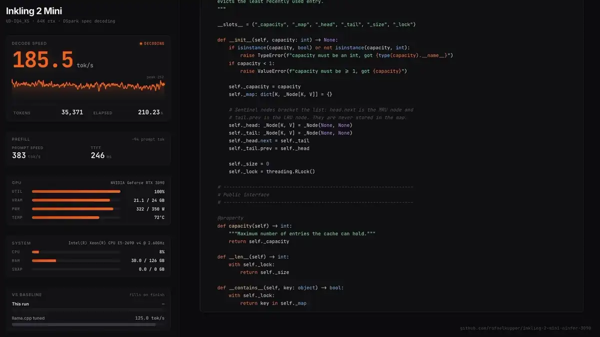
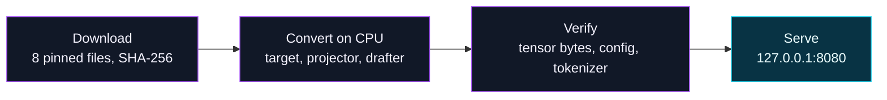
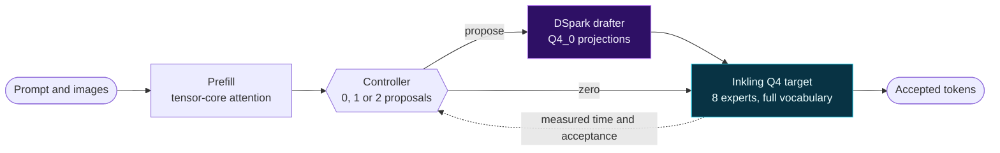
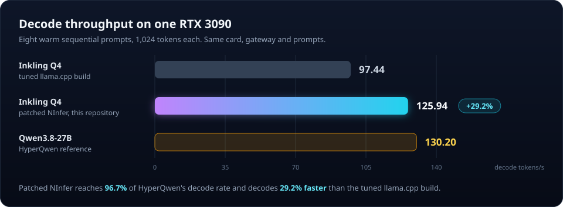
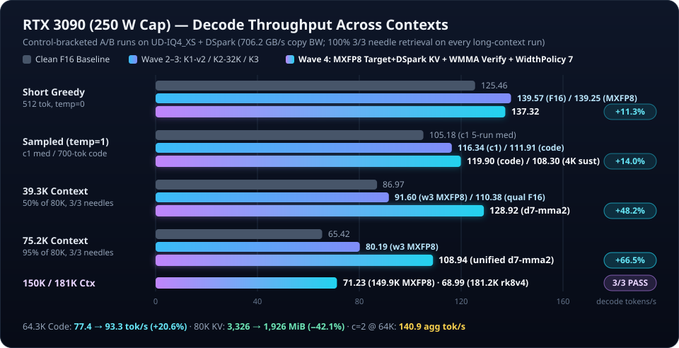
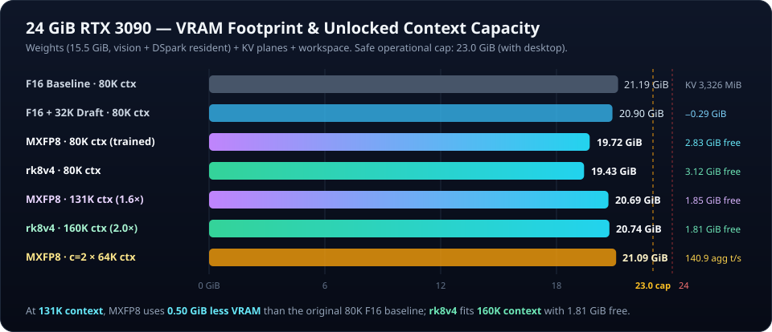
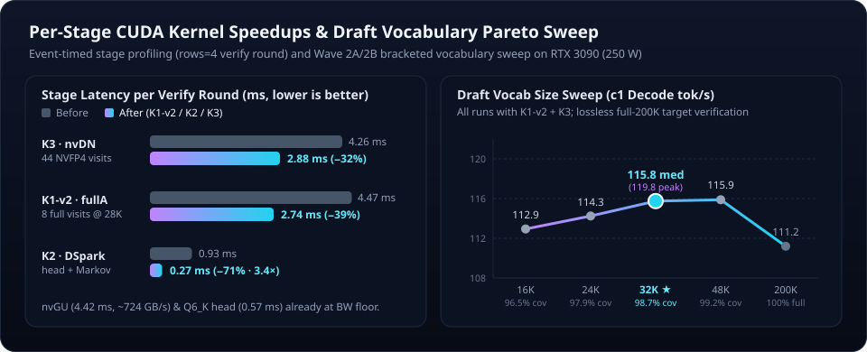
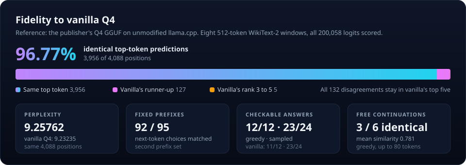

<p align="center">
  
</p>

## Credits

This repository is a thin layer over other people's work. It patches an existing engine, converts an existing quantization and measures the result.

| Component | By | Used for | License |
| --- | --- | --- | --- |
| [Inkling 2 Mini and DSpark](https://huggingface.co/thinkingmachines/Inkling-2-Mini) | Thinking Machines Lab | Model, speculative drafter and tokenizer | Apache-2.0 |
| [Inkling-2-Mini-GGUF](https://huggingface.co/unsloth/Inkling-2-Mini-GGUF) | Unsloth | UD-IQ4_XS quantization, vision projector and drafter GGUF | Apache-2.0 |
| [NInfer-all](https://github.com/iamwavecut/ninfer-all) | iamwavecut and [contributors](https://github.com/iamwavecut/ninfer-all/blob/395ce8b85627bcb2d53a1a81623088eab755443c/CONTRIBUTORS.md) | The inference engine this repository patches | Apache-2.0 |
| [llama.cpp](https://github.com/ggml-org/llama.cpp) and GGML, [Unsloth's fork](https://github.com/unslothai/llama.cpp/releases/tag/b12588-mix-c0c3de8) | Georgi Gerganov and contributors, Unsloth | GGUF reader, quantization routines and the vanilla reference | MIT |
| [HyperQwen](https://github.com/syv-ai/HyperQwen) | syv-ai | Throughput prompts and the speed target | Apache-2.0 |
| [WikiText-2](https://huggingface.co/datasets/Salesforce/wikitext) | Stephen Merity, Caiming Xiong, James Bradbury, Richard Socher and Wikipedia contributors | Full-vocabulary fidelity text | CC BY-SA 3.0 and GFDL |
| [GSM8K](https://huggingface.co/datasets/openai/gsm8k) and [ARC-Challenge](https://huggingface.co/datasets/allenai/ai2_arc) | OpenAI, Allen Institute for AI | Optional reasoning evaluation | MIT, CC BY-SA 4.0 |
| CUDA, FFmpeg and dav1d | NVIDIA, FFmpeg developers, VideoLAN and the dav1d authors | GPU runtime and media decoding | NVIDIA terms, LGPL-2.1-or-later, BSD-2-Clause |

NInfer-all builds on [Neroued/ninfer](https://github.com/Neroued/ninfer) and the [Don-Chad](https://github.com/Don-Chad/ninfer-3090) and [ashalliants](https://github.com/ashalliants/ninfer-3090) NInfer-3090 forks. [Full third-party terms](licenses/README.md) · [Project notices](NOTICE)

## Overview

<p align="center">
  
  
  
  
  
</p>

A standalone, single-GPU build of NInfer for Unsloth's **Inkling 2 Mini UD-IQ4_XS**. It serves text and images through an OpenAI-compatible API with a 65,536-token context. On an RTX 3090 it decodes **125.94 tokens/s**, 96.7% of HyperQwen's rate, and its top-token predictions match vanilla Q4 at **96.77%** of 4,088 WikiText-2 positions.

<p align="center">
  
</p>

## See it run

<p align="center">
  <a href="tests/inkling-2-mini-3090.mp4"></a>
</p>

One coding request on the RTX 3090, recorded in real time. Inkling reasons through a thread-safe O(1) LRU cache, then writes the implementation and a pytest suite. The clip above is 12 seconds of the answer. [Watch the full 4.5-minute recording](tests/inkling-2-mini-3090.mp4)

The [generated code](tests/README.md) is in `tests/`. All 44 of its tests pass, and `mypy --strict` reports no issues.

## Quick start

| Requirement | Details |
| --- | --- |
| Host | Linux x86-64 |
| GPU | RTX 3090 with 24 GB and a CUDA 13-compatible NVIDIA driver |
| Containers | Docker Compose v2 or newer and the NVIDIA Container Toolkit |
| Disk | About 45 GB for model preparation, plus Docker build space |

The server compiles from source for SM86. Preparation downloads, converts and verifies the weights on the CPU, so the GPU is needed only for serving.



**1. Build the images and prepare the model once.**

```sh
mkdir -p models
docker compose build prepare inkling
docker compose run --rm --user "$(id -u):$(id -g)" prepare
```

**2. Start the server.**

```sh
docker compose up -d inkling
curl -fsS http://127.0.0.1:8080/v1/models
```

**3. Send a request.**

```sh
curl -fsS http://127.0.0.1:8080/v1/chat/completions \
  -H 'Content-Type: application/json' \
  -d '{"model":"inkling-2-mini-q4","messages":[{"role":"user","content":"What is 17 times 6?"}],"temperature":0,"max_tokens":256}'
```

Images use the OpenAI `image_url` message format. To check one text and one image turn, run `python3 scripts/check-chat.py`.

The port binds to localhost. The health check lists available models, so it keeps working while the GPU is idle. NInfer unloads an idle model after 600 seconds and reloads it on the next request. To stop the service, run `docker compose down`.

<details>
<summary><b>Configuration and server defaults</b></summary>

<br>

| Variable | Default | Sets |
| --- | --- | --- |
| `INKLING_MODEL_DIR` | `./models` | Model data directory |
| `INKLING_GPU` | `0` | GPU index |
| `INKLING_PORT` | `8080` | Host port, bound to 127.0.0.1 |
| `BUILD_JOBS` | `6` | Compilation parallelism |

| Server setting ([`scripts/serve.sh`](scripts/serve.sh)) | Value |
| --- | --- |
| Model ID | `inkling-2-mini-q4` |
| Context and concurrency | 131,072 tokens (`INKLING_MAX_CONTEXT`), one request at a time (`INKLING_MAX_CONCURRENCY`) |
| KV cache storage | `mxfp8` (`INKLING_KV_DTYPE`, Inkling 2's trained format; also supports `rk8v4`, `int8`, `rk4v4`, `bf16`/`fp16`) |
| Inputs | Text and images, with structured output |
| Default sampling | Temperature 1, top-k 0, top-p 1, min-p 0 |
| Speculative decoding | DSpark, up to seven adaptive draft tokens (`INKLING_DRAFT_TOKENS=7`, progressive `WidthPolicy`), 32K compacted draft vocabulary (`assets/draft-vocab-32k.bin`), MXFP8 full-attention drafter KV |
| CUDA kernel optimizations | `INKLING_SHARED_VERIFY_ATTN=1` + `INKLING_VERIFY_MMA=2` (WMMA tensor-core shared-tile verify/DSpark attention), `INKLING_FAST_DOWN=1` (4-row NVFP4 down), `INKLING_MMA_PREFILL=1` |
| Idle unload | 600 seconds |

</details>

<details>
<summary><b>Download or verify the files without Docker</b></summary>

<br>

Run `python3 scripts/download-model.py models` on Linux or macOS with Python 3.11+ and curl. Add `--verify-only` to check existing files offline. Every source file has a pinned URL and SHA-256, including the 15,733,755,232-byte Q4 GGUF. Preparation checks the derived drafter and verifies the native model's tensor bytes, configuration and tokenizer against the measured build before installation. Repeating the preparation command verifies an existing native model.

</details>

## Why it's fast

Each decode step can let the small DSpark drafter guess ahead. The full Q4 model then verifies those guesses together, so each accepted guess saves a separate target step.



| Change | What it does |
| --- | --- |
| **Grouped Q8 projections** | The attention path groups up to five Q8 projections in one CUDA launch. |
| **Packed NVFP4 experts & 4-row `down` (`K3`)** | Lossless packed NVFP4 layout plus bit-exact 4-row-per-warp `packed_down_4row_kernel` (`INKLING_FAST_DOWN=1`) that caches activations in registers across 4 rows and eliminates `S=36` tail lane waste (**−32%** `nvDN` time: `4.26 → 2.88 ms`). |
| **Compacted 32K DSpark drafter (`K2`)** | DSpark's 27 backbone projections and output head use Q4_0; `INKLING_DRAFT_VOCAB` compacts `proposal_head` (`260.5 → 42.7 MB`), Markov `table_m` (`102.4 → 16.8 MB`), `table_c`, and `draft_logits` to 32,768 frequency-ranked tokens (98.66% held-out coverage), cutting `head + Markov` by **3.4×** (`0.93 → 0.27 ms/round`) and saving **−0.29 GiB VRAM** while keeping full 200,058-token target verification exact. |
| **Shared-tile & WMMA tensor-core verify attention (`K1-v2` + `VERIFY_MMA`)** | `attention_verify_kernel` (`INKLING_SHARED_VERIFY_ATTN=1`) and `attention_verify_mma_kernel` (`INKLING_VERIFY_MMA=1|2`, WMMA `16×16×16` over 64-key tiles with compile-time `KvCoding` specialization) share each KV tile across all `t ≤ 8` verify rows and 3 query heads on both target full-attention visits and DSpark's full-attention layer. Lifts 39.3K decode to **128.92 tok/s (+48.2%)** and 75.2K decode to **108.94 tok/s (+66.5% vs F16 baseline)**. |
| **MXFP8 & `rk8v4` KV planes (Target + DSpark)** | Ported from upstream `ninfer-all` and extended to DSpark's full-attention layer (`spark_rotate` + `plan_spark`) and `prompt_attention_mma` / `attention_verify_mma_kernel`. `--kv-dtype mxfp8` (Inkling 2's trained KV format, 16.5 KiB/tok target + 2.06 KiB/tok DSpark) cuts 80K KV memory **3,326 → 1,926 MiB (−42.1%)** and unlocks **163K context** or **`c=2` @ 64K** on 24 GB; `--kv-dtype rk8v4` unlocks **196K context** with vision + DSpark resident. |
| **Progressive adaptive proposals (`WidthPolicy` 0..7)** | Unified `WidthPolicy` (`capacity=8`, `--draft-tokens 7`) runs on both greedy and sampled requests, warming widths `0..3` and progressively unlocking `4..7` on high-acceptance code, edits, and tool calls without wasting wide probes on prose. |
| **Unchanged verification** | The original Q4 target always verifies proposals with all eight selected experts and the full 200,058-token vocabulary. |
| **Tensor-core prefill** | `prompt_attention_mma` accelerates long inputs across both F16 and quantized (`mxfp8`/`rk8v4`/`int8`/`rk4v4`) KV planes. |
| **KV-cache stability & TTFT fixes** | Eliminates host-cache pin leaks, redundant per-turn PCIe D2H copies (`61K TTFT: 799 → 318 ms`), and hardens reasoning-loop detection ([`patches/inkling2-stability-cache-ttft.patch`](patches/inkling2-stability-cache-ttft.patch)). |

## Benchmarks

<p align="center">
  
</p>

| Engine | Decode tokens/s | End-to-end tokens/s |
| --- | ---: | ---: |
| Inkling Q4, preceding tuned llama.cpp build | 97.44 | 94.68 |
| **Inkling Q4, patched NInfer** | **125.94** | **123.87** |
| Qwen3.8-27B, HyperQwen comparison | 130.20 | 127.95 |

Eight warm, sequential prompts generated 1,024 tokens each on the same RTX 3090. These are single-run gateway measurements of the upstream source configuration. Patched NInfer decoded 29.2% faster than the preceding Inkling build and reached 96.7% of HyperQwen's decode rate. [Reproduce the benchmarks](bench/README.md)

## RTX 3090 Optimization Findings & Quantized KV Planes (250 W Cap)

All measurements below were taken on a single **RTX 3090 (24 GiB GDDR6X, driver `580.196.07`, CUDA 13.5 `nvcc`, capped at 250 W)** with idle-GPU pre-flight verification (`util ≤ 25%`) and control-bracketed A/B runs (`ctl → candidate → ctl`). Raw ledgers, roofline math, and qualification JSONs are in [`docs/rtx3090-optimization/`](docs/rtx3090-optimization/).

<p align="center">
  
</p>

### 1. Measured Hardware & Theoretical Ceilings (250 W)

| Hardware / Model Roofline | Measured (250 W) | Notes |
| --- | ---: | --- |
| D2D copy bandwidth (512 MiB, CUDA events) | **706.2 GB/s** median (645–782) | 936.2 GB/s spec; 9,501 MHz mem |
| Sustained BF16 GEMM (8192³, FP32 acc) | **59.8 TFLOPS** (246 W, 1,035 MHz SM) | Practical MFU 0.50 = 29.9 TFLOPS; 4096³ = 79.1 TFLOPS |
| Target M=1 active weight read (48 looped visits) | **3.772 GB / step** | 1.655 GB dense + 1.737 GB routed (8/128) + 0.380 GB Q6_K LM head |
| DSpark per-round draft read (200K → 32K vocab) | **0.644 → 0.255 GB** (`k=2`) | `proposal_head` 260.5 → 42.7 MB; Markov `table_m` 102.4 → 16.8 MB |
| Decode ceiling (`c1`, 706.2 GB/s, `k=3`) | **225 / 211 / 194 tok/s** | At ctx 0 / 32K (MXFP8) / 80K (MXFP8 + shared verify) |
| Prefill ceiling (29.9 TFLOPS practical BF16) | **2,718 / 2,409 tok/s** | At 4K / 32K; measured 1,854 / 1,736 tok/s (**68–72%** of 250 W ceiling) |

### 2. End-to-End Speedup & KV Format Comparison (80K Context, Control-Bracketed)

| Configuration | KV Cache | Peak VRAM (Free) | Short Greedy (512 tok) | c1 Sampled (6-prompt med) | 39.3K Ctx Decode (50%) | 75.2K Ctx Decode (95%) | 4,096-tok Sustained | 6/6 Gates & Retrieval |
| --- | ---: | ---: | ---: | ---: | ---: | ---: | ---: | --- |
| Initial baseline (compositor GPU spin) | 3,326 MiB (F16) | 21.19 GiB | — | 84.66 tok/s | — | — | — | — |
| Clean idle F16 baseline (`ctl`) | 3,326 MiB (F16) | 21.19 GiB (1.35 GiB) | 125.46 tok/s | 105.18 tok/s *(5-run med)* | 86.97 tok/s | 65.42 tok/s | — | 3/3 needles |
| **F16 + K1-v2 / K2-32K / K3** *(lossless)* | 3,326 MiB (F16) | 20.90 GiB (1.64 GiB) | **139.57 tok/s** *(+11.3%)* | **115.75 tok/s** *(7-run med, +10.1%)* | **110.38 tok/s** *(qual, +26.9%)* | **79.37 tok/s** *(qual, +21.3%)* | 105.20 tok/s | **PASS (6/6, 3/3)** |
| **MXFP8 + K1-v2 / K2-32K / K3** *(Wave 3, scalar verify)* | 2,082 MiB (−37%) | 19.72 GiB (2.83 GiB) | **139.25 tok/s** *(+11.0%)* | **116.34 tok/s** *(+10.6%)* | 91.60 tok/s *(w3)* | 80.19 tok/s *(+22.6%)* | 106.30 tok/s | **PASS (6/6, 3/3)** |
| **MXFP8 (T+DSpark) + WMMA Verify + WidthPolicy 7** *(Wave 4)* | **1,926 MiB (−42%)** | **19.54 GiB (3.04 GiB)** | 137.32 tok/s *(+9.5%)* | 119.90 *(code t=1)* | **128.92 tok/s** *(+48.2%)* | **108.94 tok/s** *(+66.5%)* | **108.30 tok/s** | **PASS (6/6, 3/3)** |
| **`rk8v4` + K1-v2 / K2-32K / K3** *(K8/V4)* | **1,781 MiB (−46%)** | **19.43 GiB (3.12 GiB)** | **140.08 tok/s** *(+11.7%)* | 113.96 tok/s *(+8.3%)* | 82.91 tok/s *(w3)* | 73.23 tok/s *(+11.9%)* | 102.78 tok/s | **PASS (6/6, 3/3)** |

> **Harness note:** `c1 Sampled` uses 6 diverse prompts (`max_tokens=512`, `temp=1.0`, `seed=42`, `reasoning_effort=none`, [`ledger.jsonl`](docs/rtx3090-optimization/ledger.jsonl)). `Short Greedy`, `39.3K` (`50%`), `64.3K Code`, and `75.2K` (`95%`) use the control-bracketed long-context harness ([`qualification-report.json`](docs/rtx3090-optimization/qualification-report.json), [`kv-planes-report.json`](docs/rtx3090-optimization/kv-planes-report.json), [`maya-port-report.json`](docs/rtx3090-optimization/maya-port-report.json)). In Wave 4 (`VERIFY_MMA=2` + DSpark MXFP8 KV + `--draft-tokens 7`), **64.3K code decode** jumped **`77.39 → 93.33 tok/s` (+20.6%)**, **39.3K decode** hit **`115.69–128.92 tok/s`**, and **75.2K decode** hit **`108.94 tok/s` (+66.5% vs clean F16 baseline)** — all with **3/3 needle retrieval** and **6/6 acceptance gates PASS**.

### 3. Unlocked Extended Context & Concurrency on 24 GiB VRAM

<p align="center">
  
</p>

| Extended Configuration (Single RTX 3090, 24 GiB, Vision + DSpark Resident) | KV Cache | Peak VRAM | Free VRAM | Measured Prompt | Prefill | Decode / Aggregate | Needle Retrieval |
| --- | ---: | ---: | ---: | ---: | ---: | ---: | --- |
| **MXFP8 @ 131,072 ctx (`c=1`, Wave 3 scalar)** | 3,066 MiB | **20.69 GiB** | **1.85 GiB** | 121,222 tok | 825.4 tok/s | 51.01 tok/s | **3/3 PASS** |
| **MXFP8 (T+DSpark) @ 163,840 ctx (`c=1`, Wave 4 WMMA)** | 3,411 MiB | **21.05 GiB** | **1.21 GiB** | **149,940 tok** | 756.8 tok/s | **71.23 tok/s** | **3/3 PASS** |
| **`rk8v4` (T+DSpark) @ 196,608 ctx (`c=1`, Wave 4 WMMA)** | 3,284 MiB | **20.93 GiB** | **1.13 GiB** | **181,225 tok** | 677.9 tok/s | **68.99 tok/s** | **3/3 PASS** |
| **MXFP8 @ 65,536 ctx (`c=2` concurrent)** | 3,495 MiB | **21.09 GiB** | **1.46 GiB** | 2 × 512 tok | — | **140.87 agg tok/s** *(71.7 + 72.8)* | — |

### 4. Per-Stage Kernel Speedups, Draft Vocab Sweep & Rejected Levers

<p align="center">
  
</p>

<details>
<summary><b>Acceptance gates, Wave 2A/2B hill-climb ledger &amp; rejected levers</b></summary>

<br>

**6/6 Acceptance Gates (MXFP8 & `rk8v4` & F16+K123, clean production build):**

| Gate | F16 + K123 | MXFP8 + K123 | `rk8v4` + K123 |
| --- | --- | --- | --- |
| Model load (`/v1/models`) | PASS (`inkling-2-mini-q4`) | PASS (`inkling-2-mini-q4`) | PASS (`inkling-2-mini-q4`) |
| Chat (`stop` finish) | PASS (`Paris`) | PASS (`Paris`) | PASS (`Paris`) |
| Reasoning (`17*23+41`) | PASS (`reasoning_len=163`, `432`) | PASS (`reasoning_len=208`, `432`) | PASS (`reasoning_len=163`, `432`) |
| Tool-call round-trip | PASS (`X9K7Q2-VERIFIED`) | PASS (`X9K7Q2-VERIFIED`) | PASS (`X9K7Q2-VERIFIED`) |
| Vision (`natural_scene.png`) | PASS (`24; sun is in the upper right sky.`) | PASS (`24; sun is in the upper right sky.`) | PASS (`24; top right.`) |
| Sustained 4,096-tok decode | PASS (`105.20 tok/s`, no loop) | PASS (`106.30 tok/s`, no loop) | PASS (`102.78 tok/s`, no loop) |

**Tested & Rejected Levers (Wave 1A–2B):**

| Lever | Result | Reason Rejected |
| --- | --- | --- |
| `INKLING_FAST_GU=1` (4-row NVFP4 `gate_up`) | `nvGU` regressed `4.53 → 5.12 ms` | Register pressure; original `packed_kernel<2304>` was already at ~724 GB/s (copy BW ceiling) |
| `INKLING_FULL_SPLITS=48` | 28K `fullA` regressed `2.74 → 3.41 ms` | Extra split-merge overhead vs default `20` splits |
| `INKLING_FAST_DOWN=2` (2-row NVFP4 `down`) | `111.60` vs `115.75 tok/s` (−3.6%) | Worse than 4-row when combined with K1-v2 + K2 |
| `INKLING_SHARED_VERIFY_ATTN=2` (sliding + full) | `113.97` vs `115.75 tok/s` (−1.5%) | Sliding window (`W=1024`) has small KV; full-attention only (`=1`) wins |
| Draft vocab `16K` / `24K` / `48K` | `112.94` / `114.25` / `115.88 tok/s` | `16K` (96.5% cov) and `24K` (97.9% cov) lose draft acceptance; `48K` adds VRAM with no gain over `32K` (98.66% cov) |
| `INKLING_DRAFT_ROWS=4` | Acceptance fell `306 → 281` | Hurts DSpark non-causal context quality |
| Fixed `k=3` without `--adaptive-mtp` | `115.19` vs `115.75 tok/s` | Inside noise; adaptive controller protects low-acceptance prompts |

</details>

## Fidelity

<p align="center">
  
</p>

The reference is the publisher's original Q4 GGUF on unmodified CUDA llama.cpp with speculative decoding disabled.

- **Full vocabulary.** Eight disjoint 512-token WikiText-2 windows gave **3,956/4,088 identical top-token predictions (96.77%)**, scoring all 200,058 token logits at each position. Of the 132 disagreements, 127 selected vanilla Q4's runner-up and all 132 selected a top-five token. Perplexity was **9.25762** versus **9.23235** for vanilla Q4.
- **Fixed prefixes.** On a second set of 95 fixed prefixes, 92 next-token choices matched.
- **Free generation.** When each engine generated freely for up to 80 tokens, three of six greedy continuations were identical. Mean token-sequence similarity across the six was **0.781** (Python's `SequenceMatcher` ratio).
- **Answers.** On 12 checkable questions, optimized Q4 scored **12/12 greedy and 23/24 sampled**, versus **11/12 and 23/24** for vanilla Q4 at the same 768-token budget.

These tests measure token and answer fidelity on the stated samples. [Full-vocabulary scoring](bench/quality/README.md) · [Answer and token comparisons](bench/README.md#answer-and-token-comparisons)

## Repository layout

```text
.
├── Dockerfile                   Engine source, CPU preparation, CUDA build and runtime stages
├── compose.yaml                 prepare (setup profile) and inkling services
├── patches/                     RTX 3090 patches on top of NInfer-all 395ce8b
├── assets/                      32K frequency-ranked DSpark draft vocabulary subset
├── scripts/                     Download, convert, verify, build-draft-vocab, serve and smoke-test
├── bench/                       Throughput, fidelity, reasoning and idle-unload harnesses
├── tests/                       Demo recording and the code Inkling generated in it
├── docs/assets/                 README graphics and demo clip
├── docs/rtx3090-optimization/   Roofline model, hill-climb ledger, and qualification reports
└── licenses/                    Third-party notices
```

## License

The RTX 3090 patch, preparation scripts and evaluations were developed with OpenAI Codex and are licensed under [Apache-2.0](LICENSE). Model and dependency licenses are listed in [Credits](#credits) and [licenses/README.md](licenses/README.md). The repository publishes source and build recipes. It does not publish compiled images or converted models.
