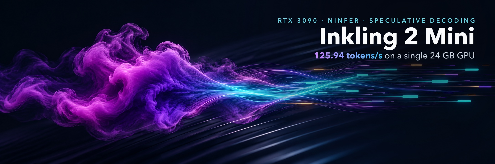
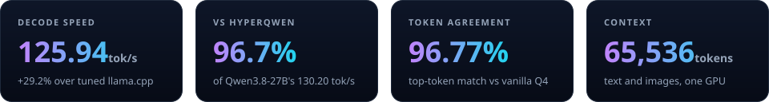
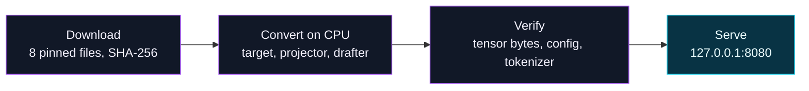

<p align="center">
  
</p>

## Credits

This repository is a thin layer over other people's work. It patches an existing engine, converts an existing quantization and measures the result.

| Component | By | Used for | License |
| --- | --- | --- | --- |
| [Inkling 2 Mini and DSpark](https://huggingface.co/thinkingmachines/Inkling-2-Mini) | Thinking Machines Lab | Model, speculative drafter and tokenizer | Apache-2.0 |
| [Inkling-2-Mini-GGUF](https://huggingface.co/unsloth/Inkling-2-Mini-GGUF) | Unsloth | UD-IQ4_XS quantization, vision projector and drafter GGUF | Apache-2.0 |
| [NInfer-all](https://github.com/iamwavecut/ninfer-all) | iamwavecut and [contributors](https://github.com/iamwavecut/ninfer-all/blob/395ce8b85627bcb2d53a1a81623088eab755443c/CONTRIBUTORS.md) | The inference engine this repository patches | Apache-2.0 |
| [llama.cpp](https://github.com/ggml-org/llama.cpp) and GGML, [Unsloth's fork](https://github.com/unslothai/llama.cpp/releases/tag/b12588-mix-c0c3de8) | Georgi Gerganov and contributors, Unsloth | GGUF reader, quantization routines and the vanilla reference | MIT |
| [HyperQwen](https://github.com/syv-ai/HyperQwen) | syv-ai | Throughput prompts and the speed target | Apache-2.0 |
| [WikiText-2](https://huggingface.co/datasets/Salesforce/wikitext) | Stephen Merity, Caiming Xiong, James Bradbury, Richard Socher and Wikipedia contributors | Full-vocabulary fidelity text | CC BY-SA 3.0 and GFDL |
| [GSM8K](https://huggingface.co/datasets/openai/gsm8k) and [ARC-Challenge](https://huggingface.co/datasets/allenai/ai2_arc) | OpenAI, Allen Institute for AI | Optional reasoning evaluation | MIT, CC BY-SA 4.0 |
| CUDA, FFmpeg and dav1d | NVIDIA, FFmpeg developers, VideoLAN and the dav1d authors | GPU runtime and media decoding | NVIDIA terms, LGPL-2.1-or-later, BSD-2-Clause |

NInfer-all builds on [Neroued/ninfer](https://github.com/Neroued/ninfer) and the [Don-Chad](https://github.com/Don-Chad/ninfer-3090) and [ashalliants](https://github.com/ashalliants/ninfer-3090) NInfer-3090 forks. [Full third-party terms](licenses/README.md) · [Project notices](NOTICE)

## Overview

<p align="center">
  
  
  
  
  
</p>

A standalone, single-GPU build of NInfer for Unsloth's **Inkling 2 Mini UD-IQ4_XS**. It serves text and images through an OpenAI-compatible API with a 65,536-token context. On an RTX 3090 it decodes **125.94 tokens/s**, 96.7% of HyperQwen's rate, and its top-token predictions match vanilla Q4 at **96.77%** of 4,088 WikiText-2 positions.

<p align="center">
  
</p>

## See it run

<p align="center">
  <a href="tests/inkling-2-mini-3090.mp4"></a>
</p>

One coding request on the RTX 3090, recorded in real time. Inkling reasons through a thread-safe O(1) LRU cache, then writes the implementation and a pytest suite. The clip above is 12 seconds of the answer. [Watch the full 4.5-minute recording](tests/inkling-2-mini-3090.mp4)

The [generated code](tests/README.md) is in `tests/`. All 44 of its tests pass, and `mypy --strict` reports no issues.

## Quick start

| Requirement | Details |
| --- | --- |
| Host | Linux x86-64 |
| GPU | RTX 3090 with 24 GB and a CUDA 13-compatible NVIDIA driver |
| Containers | Docker Compose v2 or newer and the NVIDIA Container Toolkit |
| Disk | About 45 GB for model preparation, plus Docker build space |

The server compiles from source for SM86. Preparation downloads, converts and verifies the weights on the CPU, so the GPU is needed only for serving.



**1. Build the images and prepare the model once.**

```sh
mkdir -p models
docker compose build prepare inkling
docker compose run --rm --user "$(id -u):$(id -g)" prepare
```

**2. Start the server.**

```sh
docker compose up -d inkling
curl -fsS http://127.0.0.1:8080/v1/models
```

**3. Send a request.**

```sh
curl -fsS http://127.0.0.1:8080/v1/chat/completions \
  -H 'Content-Type: application/json' \
  -d '{"model":"inkling-2-mini-q4","messages":[{"role":"user","content":"What is 17 times 6?"}],"temperature":0,"max_tokens":256}'
```

Images use the OpenAI `image_url` message format. To check one text and one image turn, run `python3 scripts/check-chat.py`.

The port binds to localhost. The health check lists available models, so it keeps working while the GPU is idle. NInfer unloads an idle model after 600 seconds and reloads it on the next request. To stop the service, run `docker compose down`.

<details>
<summary><b>Configuration and server defaults</b></summary>

<br>

| Variable | Default | Sets |
| --- | --- | --- |
| `INKLING_MODEL_DIR` | `./models` | Model data directory |
| `INKLING_GPU` | `0` | GPU index |
| `INKLING_PORT` | `8080` | Host port, bound to 127.0.0.1 |
| `BUILD_JOBS` | `6` | Compilation parallelism |

| Server setting ([`scripts/serve.sh`](scripts/serve.sh)) | Value |
| --- | --- |
| Model ID | `inkling-2-mini-q4` |
| Context and concurrency | 65,536 tokens, one request at a time |
| Inputs | Text and images, with structured output |
| Default sampling | Temperature 1, top-k 0, top-p 1, min-p 0 |
| Speculative decoding | DSpark, up to two draft tokens |
| Idle unload | 600 seconds |

</details>

<details>
<summary><b>Download or verify the files without Docker</b></summary>

<br>

Run `python3 scripts/download-model.py models` on Linux or macOS with Python 3.11+ and curl. Add `--verify-only` to check existing files offline. Every source file has a pinned URL and SHA-256, including the 15,733,755,232-byte Q4 GGUF. Preparation checks the derived drafter and verifies the native model's tensor bytes, configuration and tokenizer against the measured build before installation. Repeating the preparation command verifies an existing native model.

</details>

## Why it's fast

Each decode step can let the small DSpark drafter guess ahead. The full Q4 model then verifies those guesses together, so each accepted guess saves a separate target step.


| Change | What it does |
| --- | --- |
| **Grouped Q8 projections** | The attention path groups up to five Q8 projections in one CUDA launch. |
| **Packed NVFP4 experts** | A lossless layout change lets the GPU read the routed experts' weights more efficiently. |
| **Lighter drafter** | DSpark's 27 backbone projections and its output projection use smaller Q4_0 copies. |
| **Adaptive proposals** | A per-request controller uses measured time and acceptance to propose zero, one or two tokens. |
| **Unchanged verification** | The original Q4 target always verifies proposals with all eight selected experts and the full vocabulary. |
| **Tensor-core prefill** | A tensor-core attention kernel accelerates long inputs. In the native engine, a 65,504-token retrieval fell from 72.09 to 37.40 seconds. |
| **Stable prompt caching** | Greedy prompt caching uses reproducible boundaries. |

## Benchmarks

<p align="center">
  
</p>

| Engine | Decode tokens/s | End-to-end tokens/s |
| --- | ---: | ---: |
| Inkling Q4, preceding tuned llama.cpp build | 97.44 | 94.68 |
| **Inkling Q4, patched NInfer** | **125.94** | **123.87** |
| Qwen3.8-27B, HyperQwen comparison | 130.20 | 127.95 |

Eight warm, sequential prompts generated 1,024 tokens each on the same RTX 3090. These are single-run gateway measurements of the source configuration packaged here. Patched NInfer decoded 29.2% faster than the preceding Inkling build and reached 96.7% of HyperQwen's decode rate. [Reproduce the benchmarks](bench/README.md)

## Fidelity

<p align="center">
  
</p>

The reference is the publisher's original Q4 GGUF on unmodified CUDA llama.cpp with speculative decoding disabled.

- **Full vocabulary.** Eight disjoint 512-token WikiText-2 windows gave **3,956/4,088 identical top-token predictions (96.77%)**, scoring all 200,058 token logits at each position. Of the 132 disagreements, 127 selected vanilla Q4's runner-up and all 132 selected a top-five token. Perplexity was **9.25762** versus **9.23235** for vanilla Q4.
- **Fixed prefixes.** On a second set of 95 fixed prefixes, 92 next-token choices matched.
- **Free generation.** When each engine generated freely for up to 80 tokens, three of six greedy continuations were identical. Mean token-sequence similarity across the six was **0.781** (Python's `SequenceMatcher` ratio).
- **Answers.** On 12 checkable questions, optimized Q4 scored **12/12 greedy and 23/24 sampled**, versus **11/12 and 23/24** for vanilla Q4 at the same 768-token budget.

These tests measure token and answer fidelity on the stated samples. [Full-vocabulary scoring](bench/quality/README.md) · [Answer and token comparisons](bench/README.md#answer-and-token-comparisons)

## Repository layout

```text
.
├── Dockerfile        Engine source, CPU preparation, CUDA build and runtime stages
├── compose.yaml      prepare (setup profile) and inkling services
├── patches/          RTX 3090 changes to NInfer-all 395ce8b
├── scripts/          Download, convert, verify, serve and smoke-test
├── bench/            Throughput, fidelity, reasoning and idle-unload harnesses
├── tests/            Demo recording and the code Inkling generated in it
├── docs/assets/      README graphics and demo clip
└── licenses/         Third-party notices
```

## License

The RTX 3090 patch, preparation scripts and evaluations were developed with OpenAI Codex and are licensed under [Apache-2.0](LICENSE). Model and dependency licenses are listed in [Credits](#credits) and [licenses/README.md](licenses/README.md). The repository publishes source and build recipes. It does not publish compiled images or converted models.
